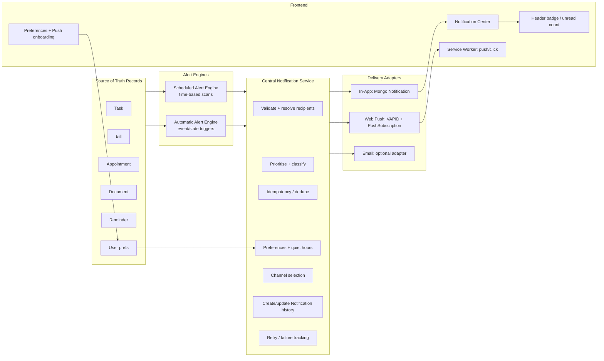
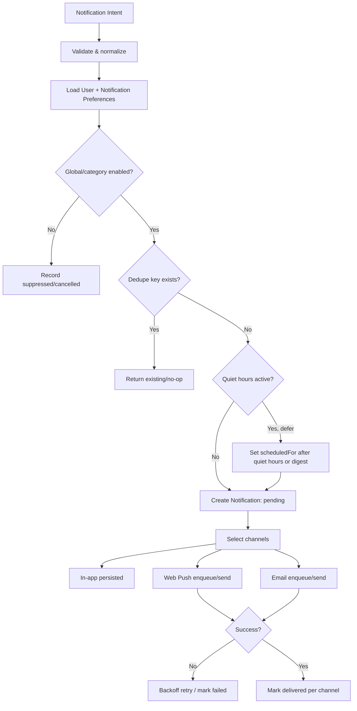
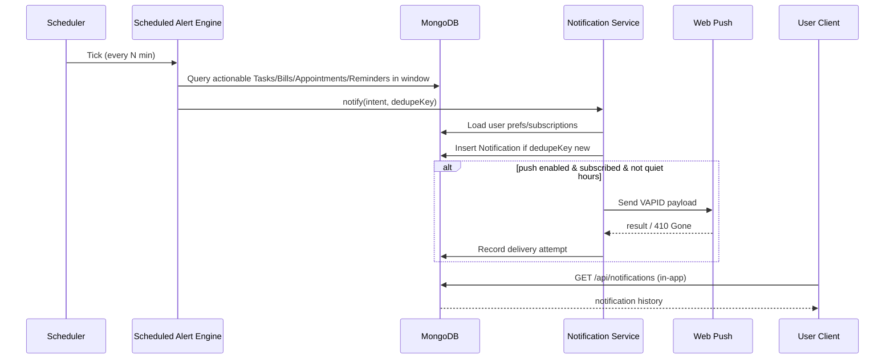
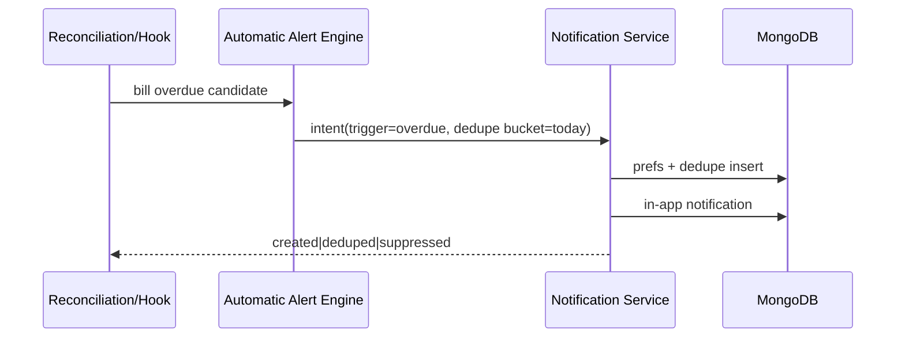

# LifeAdmin — Notification Architecture

> **Status:** Design / proposal only. **No app code, dependencies, frameworks, auth, or modules are changed by this document.**  
> **Scope:** Scheduled Alerts + Automatic Alerts, central Notification Service, delivery channels, reliability, frontend integration, API proposals, and conflict report.  
> **Grounding:** Inspected repo state as of 2026-11-05 — Express 5 + TypeScript + MongoDB/Mongoose backend; React 19 + Vite + Tailwind CSS 4 + Axios (`baseURL:'/api'`) + React Hot Toast frontend; JWT auth (`server/src/middleware/auth.ts`, `req.user`); shared types in `shared/types.ts`. Existing models/routes: `Notification`, `Reminder`, `User`, `Task`, `Bill`, `Appointment`; routes mounted in `server/src/index.ts`. **No scheduler/cron, queue, Web Push, service worker, or PWA manifest currently exists.**

---

## 1. Goals & Non-Goals

### Goals
- Deliver **in-app notifications** reliably for time-based and state-based life-admin events.
- Add **Web Push** as an optional, permission-based channel for supported browsers/PWAs.
- Keep **email optional** (disabled by default; only when explicitly configured).
- Reuse existing source records (`Task`, `Bill`, `Appointment`, `Document`/future entities) and existing user preference fields where practical — **no duplicate business data**.
- Preserve current architecture, auth, route style, and UI design system (Ocean Teal light / Deep Ocean dark).
- Guarantee **at-least-once evaluation with idempotent delivery creation** (no duplicate user-visible notifications for the same logical alert occurrence).

### Non-Goals (this phase)
- Real-time exact-second delivery guarantees (Web Push and OS scheduling are best-effort).
- SMS, native mobile push (APNs/FCM native SDKs), or third-party notification SaaS unless explicitly approved later.
- Migrating to Next.js, Supabase, Firebase, Prisma, or foreign backend services.
- Subscription/paywall gating — LifeAdmin remains free.

---

## 2. Existing vs Proposed (Summary)

| Area | Existing | Proposed |
|---|---|---|
| Notification record | `server/src/models/Notification.ts`: `title,message,type[reminder|deadline|overdue|ai_suggestion|system],entityType/entityId,read/readAt,pushSent/pushSentAt` | Evolve schema (backward-compatible migration path): add `category`, `priority`, `channelState`, `deliveryAttempts`, `dedupeKey`, `occurrenceAt`, `scheduledFor`, `sourceSnapshot` (minimal), `actionUrl/deepLink`, `expiresAt`, `status` (`pending|delivered|failed|cancelled|suppressed`). Keep `pushSent` fields for compatibility or map to channel state. |
| Reminders | `Reminder` model + `/api/reminders` CRUD/ack; `lastNotifiedAt/notificationCount` | Keep `Reminder` as user-managed/custom reminder source. Add scheduler-driven `reminder_due` evaluation using `reminderDaysBefore`/due date/time + dedupe keys; sync `lastNotifiedAt/notificationCount` atomically when a delivery is created. |
| User prefs | `User.notificationsEnabled, defaultReminderTiming, quietHoursStart/End, categories, aiPreferences` | Keep existing fields. Add optional `notificationPreferences` subdocument/collection for per-category channels, automatic-alert toggles, push/email opt-in, timezone, quiet-hours behavior, digest/fallback prefs. Respect `notificationsEnabled` as global kill switch. |
| Routes | `GET /api/notifications`, `PATCH /:id/read`, `PATCH /read-all`, `DELETE /:id` | Extend with pagination/cursor, unread count, bulk actions, preferences endpoints, push subscription endpoints; keep existing paths working. |
| Delivery | In-app only (stored records) | Add Notification Service + delivery adapters: `in_app` (DB), `web_push` (VAPID), optional `email`. |
| Scheduling | None | Scheduled Alert Engine (time-based) + Automatic Alert Engine (state/event-based), driven by a scheduler/worker abstraction. |
| Frontend | `RemindersPage`, `SettingsPage` exist; no notification center/badge/SW | Notification center (drawer/panel), header badge, preferences UI, push permission onboarding, deep links, service worker for push display/click. |
| PWA | No manifest/SW/Vite PWA plugin | Add web manifest + service worker registration (minimal, push-focused) when Web Push is implemented. |

---

## 3. High-Level Architecture



### Component Responsibilities

1. **Scheduled Alert Engine** — periodic, idempotent evaluation of upcoming/overdue items from source records and active reminders. Produces *logical alert occurrences* (e.g., `bill:123:due_in:3d:2026-11-08T00:00:00Z`).
2. **Automatic Alert Engine** — evaluates state transitions/configurable conditions (overdue, status change, missing completion, document expiry, unusual/rescheduled patterns as data supports). Can be invoked from domain events/hooks or a periodic reconciliation scan.
3. **Central Notification Service** — single entry point for creating notifications. Enforces validation, per-user isolation, dedupe, preferences/quiet hours, channel routing, persistence, and delivery attempt tracking.
4. **Delivery Adapters** — channel-specific senders. They never decide business eligibility; they only attempt delivery and report normalized outcomes.
5. **Frontend Notification UX** — displays in-app history/unread state, manages preferences, requests push permission, registers subscriptions, and handles deep-link navigation.

---

## 4. Scheduled Alert Engine

### 4.1 Inputs (reuse existing sources)
| Source | Existing fields used | Proposed scheduled alerts |
|---|---|---|
| `Task` | `dueDate`, `dueTime?`, `status`, `priority`, `reminderDaysBefore`, `userId` | Due soon (N days/hours before, using `reminderDaysBefore` or user defaults), due today, overdue (if not completed/cancelled by app rules). |
| `Bill` | `dueDate`, `paymentStatus`, `amount`, `currency` (default ₹), `recurrence`, `reminderDaysBefore`, `provider` | Upcoming payment, due today, overdue/unpaid, recurring next-cycle reminder (derived, not duplicating bill record). |
| `Appointment` | `date`, `time`, `endTime?`, `reminderDaysBefore`, `location` | Upcoming appointment (e.g., 1 day/1 hour/default offsets), starting soon (optional), missed/past follow-up (configurable). Calendar remains aggregation; alerts originate from Appointment/source semantics, not Calendar copies. |
| `Reminder` | `dueDate`, `dueTime`, `reminderDaysBefore`, `status`, `entityType/entityId`, `lastNotifiedAt` | Custom reminder due; linked-entity reminder follow-up. |
| `Document` (future/AI extracted) | `aiExtracted.expiryDate/renewalDate/importantDates` | Expiry/renewal alerts when fields exist and category enabled. |

### 4.2 Evaluation Model
- Run on a **fixed cadence** (e.g., every 1–5 minutes for near-term scans; hourly/daily reconciliation for far-future windows) — exact schedule configurable.
- Use **time windows** (`now` to `now + lookahead`) and **overdue windows** (`due < now`, status still actionable) to avoid full-table scans.
- Compute an **occurrence instant** (`occurrenceAt`) in UTC for dedupe; display in user's timezone.
- For each candidate, build a **Notification Intent**:
  ```ts
  interface NotificationIntent {
    userId: string;
    sourceType: 'task'|'bill'|'appointment'|'reminder'|'document'|'system';
    sourceId?: string;
    category: 'task'|'bill'|'appointment'|'reminder'|'document'|'system'|'ai';
    trigger: 'due_soon'|'due_today'|'overdue'|'starting_soon'|'expired'|'renewal'|'custom';
    occurrenceAt: string; // ISO UTC, logical alert time bucket
    scheduledFor?: string; // intended delivery time
    priority: 'low'|'normal'|'high'|'urgent';
    title: string;
    body: string;
    actionUrl?: string; // deep link, e.g. /tasks/:id
    dedupeKey: string;
    metadata?: Record<string, string|number|boolean|null>;
  }
  ```
- Pass intents to Notification Service. The service is responsible for dedupe/insert.

### 4.3 Dedupe Key Strategy
Dedupe keys must be deterministic and stable across retries/restarts:
```text
v1:{userId}:{sourceType}:{sourceId}:{trigger}:{occurrenceBucket}
```
Examples:
- `v1:u123:bill:b456:due_soon:2026-11-08T00:00:00Z` (3-day-before bucket)
- `v1:u123:task:t789:overdue:2026-11-05` (daily overdue bucket; avoids spamming every scan)
- `v1:u123:reminder:r321:custom:2026-11-05T09:30:00Z`

Store a unique index on `(userId, dedupeKey)` for active/pending/delivered logical alerts as appropriate (see schema doc). Use Mongo duplicate-key handling as the final idempotency guard.

---

## 5. Automatic Alert Engine

Automatic alerts are **configurable** and fire from state changes or reconciliation rules.

| Category | Trigger condition | Default | Notes |
|---|---|---|---|
| Overdue task | `Task.status != completed` and due passed | On | Daily capped by dedupe bucket; respects completion. |
| Overdue bill | `Bill.paymentStatus` pending/upcoming and due passed | On | Distinct from scheduled "due soon"; currency display ₹. |
| Missed appointment follow-up | Appointment ended/passed without user-marked outcome (future field) | Off/proposed | Requires explicit product rule; do not infer without status model. |
| Payment recorded / state change | Bill marked paid, task completed, etc. | Off (except optional positive nudge) | Positive, non-punitive messaging; LifeBuddy can react in UI later, not as push spam. |
| Document expiry/renewal | `Document.aiExtracted.expiryDate` approaching/passed | On when data exists | Only if extraction fields populated. |
| Reschedule/cancel detected | Source date/status changed after prior alert | On | Cancel/suppress obsolete pending alerts; optionally notify user of change if enabled. |
| Unusual pattern (AI suggestion) | AI/heuristic flags anomaly | Off, explicit opt-in | Use existing `ai_suggestion` type semantics; no automatic sensitive actions. |

### 5.1 Event Hooks (proposed integration points)
Domain routes currently perform direct Mongoose writes (`tasks`, `bills`, `appointments`, `reminders`). Proposed minimal integration:
- After successful create/update/delete/status change, call `NotificationService.publishDomainEvent(...)` (in-process) or enqueue a job.
- Hooks must be **non-blocking for the main response path** where practical (fire-and-forget with internal error logging) unless strong consistency is required.
- A periodic reconciliation scan remains the safety net for missed hooks/process crashes.

---

## 6. Central Notification Service

### 6.1 Responsibilities
1. **Creation** — accept `NotificationIntent`(s) from engines/adapters/internal callers.
2. **Validation** — require `userId`, category/type mapping, source ownership compatibility, safe text lengths.
3. **Prioritisation** — assign `priority` and optional delivery ordering (`urgent > high > normal > low`).
4. **Deduplication / idempotency** — unique `dedupeKey` guard; return existing record on duplicate logical occurrence.
5. **Preference resolution** — global `notificationsEnabled`, per-category toggles, per-channel toggles, quiet hours, timezone.
6. **Channel selection** — decide `in_app`, `web_push`, `email` based on prefs/subscriptions/availability.
7. **History & read state** — persist notification records; track read/unread, archived/deleted per existing API behavior.
8. **Retries/failure tracking** — per-channel attempt records, exponential backoff, terminal failure state.
9. **Per-user isolation** — every query/write scoped by authenticated `userId`; never cross-user fan-out except system admin tooling (none proposed).

### 6.2 Processing Pipeline


### 6.3 Quiet Hours
- Existing `User.quietHoursStart/quietHoursEnd` (strings like `"22:00"`) should be interpreted in the **user's timezone** (proposed `User.timezone` or preference field; fallback to server/app default with explicit behavior).
- During quiet hours: suppress push/email; keep in-app record available (or mark deferred) per preference. Urgent/security notifications can override only if explicitly modeled later — default: respect quiet hours.
- Handle windows crossing midnight.

### 6.4 Priority Model
| Priority | Examples | Behavior |
|---|---|---|
| `urgent` | Overdue critical bill (configurable), imminent appointment safety reminder | Highest sort; eligible for push if enabled; still respects dedupe. |
| `high` | Due today, appointment within 1 hour | Push/in-app prominent. |
| `normal` | Due soon | Standard delivery. |
| `low` | Suggestions, digest items | May be batched/digest depending on prefs. |

---

## 7. Delivery Channels

### 7.1 In-App Notification Center
- **Source:** `Notification` collection, scoped to `req.user._id` (existing pattern).
- **Capabilities:** list/filter (unread, category, type), pagination/cursor, mark read, mark all read, delete/archive, deep link to entity.
- **UI:** bell icon + unread badge in app header; drawer/panel using shared UI patterns (portal/modal conventions where appropriate) and Ocean Teal/Deep Ocean tokens.

### 7.2 Web Push
- **Requirements (proposed):** `web-push` library (VAPID keys in env vars, never committed), `PushSubscription` storage, HTTPS in production, service worker.
- **Subscription flow:** user enables push in Settings → browser permission prompt → app registers SW → `pushManager.subscribe()` with VAPID public key → POST subscription to `/api/notifications/push/subscriptions`.
- **Payload:** minimal JSON (`title`, `body`, `url/deepLink`, `notificationId`, `icon/badge` paths). Do not include secrets or sensitive full payloads.
- **Click handling:** SW `notificationclick` focuses/open client and navigates to deep link; mark delivered/opened as feasible.
- **Expiration:** handle `410 Gone`/`404` by deleting invalid subscriptions.

### 7.3 Optional Email
- Disabled unless email provider config exists and user opts in.
- Use adapter interface (`sendEmailNotification`) so provider (SMTP, Resend, SES, etc.) can be chosen later with approval.
- Same dedupe/preferences/quiet-hours rules apply.

### 7.4 iOS / PWA Limitations (must communicate in UI/docs)
- Web Push on iOS requires supported iOS/Safari versions and the app installed to Home Screen (PWA context) with user-granted permission — behavior varies by OS version.
- **No exact-time delivery guarantee:** push delivery depends on browser/vendor push services, network, OS power/battery policies, and quiet/focus modes.
- Service worker may be evicted; background execution is limited.
- Fallback: in-app notifications are always available when user opens the app; scheduled scans create records even if push fails.

---

## 8. Reliability & Failure Handling

| Concern | Design |
|---|---|
| Process restart | Scheduled state is derived from source records + dedupe keys in Mongo; no in-memory-only schedule is authoritative. Pending jobs/claims stored persistently when using a queue. |
| Duplicate delivery | Deterministic `dedupeKey` + unique index + duplicate-key no-op; delivery adapters check/send idempotently where provider supports keys. |
| Retries | Exponential backoff with jitter for transient push/network errors; max attempts; record `lastError`, `nextAttemptAt`, `attemptCount`. Do not retry permanent failures (invalid subscription 410/404, malformed payload). |
| Timezones/DST | Store UTC instants for `occurrenceAt/scheduledFor/createdAt`; resolve quiet hours/local display using user timezone (IANA). Recompute next runs using timezone-aware library if/when added (dependency approval required). Document DST edge cases. |
| Reschedule/cancel | When source due date/status changes, recompute future intents: cancel/suppress obsolete pending notifications tied to old occurrence keys; create new dedupe keys for new occurrences. |
| Quiet hours | Defer push/email or mark suppressed by preference; never drop audit/history silently without a recorded status. |
| Failed delivery tracking | Per-channel status: `pending/sent/delivered/failed/skipped/suppressed`; keep provider response/error code (sanitized). |
| Per-user isolation | All queries include `userId`; push subscriptions owned by user; admin/global broadcasts out of scope. |
| Observability (proposed) | Structured logs with `notificationId`, `dedupeKey`, `userId`, `channel`, `result`; metrics counters for scanned/created/suppressed/sent/failed/deduped. |

---

## 9. Scheduler/Worker Evaluation: `node-cron` vs Persistent Queue

### Option A — `node-cron` (in-process)
**Pros**
- Simple to add for periodic scans; low operational overhead; fits current single-process Express server.
- Good for MVP scheduled scans (e.g., every minute) and reconciliation.

**Cons**
- Runs only while process is alive; missed windows during deploy/crash until next tick (mitigated by windowed/dedupe scans).
- No distributed locking/claiming across multiple server instances; multi-instance deploys can double-scan unless a leader/lock is added.
- Retry/backoff and per-job observability are manual.
- Long-running scans can block event loop if not carefully batched.

**Fit:** acceptable for initial single-instance deployment if scans are idempotent, windowed, and batched.

### Option B — Persistent Queue (Mongo-backed jobs, BullMQ/Redis, Agenda, etc.)
**Pros**
- Durable jobs, retries/backoff, delayed jobs, visibility, concurrency controls.
- Better for push/email delivery retries and future scale.

**Cons**
- New infrastructure/dependency (Redis for BullMQ; or Mongo job collection design). Requires approval per AGENTS constraints.
- More operational complexity.

**Fit:** preferred when multiple instances, strict retry semantics, or high notification volume are expected.

### Recommendation (phased)
1. **Phase 1 (MVP):** implement a small internal scheduler abstraction + idempotent scan jobs. Start with `node-cron` *or* equivalent timer only after dependency approval; if avoiding new deps initially, a guarded `setInterval` in server bootstrap with env flag can run scans in dev/single instance — **but production should use an explicit scheduler/worker strategy**.
2. **Phase 2:** introduce durable delivery queue (technology choice requires explicit approval). Keep Notification Service interface stable so engines/adapters do not change.

> **Conflict to resolve before implementation:** server currently has no scheduling dependency. Adding `node-cron`/`agenda`/`bullmq`/`web-push` requires dependency and ops approval.

---

## 10. Proposed API Surface (extends existing conventions)

All routes under `/api/notifications` (existing mount), JWT-protected via `authenticate`, `req.user._id` scoped. Response shapes follow current `{ message?, ... }`/resource patterns; errors use existing middleware style.

### Existing (keep compatible)
- `GET /api/notifications` — list (`?unreadOnly=true&limit=50`).
- `PATCH /api/notifications/:id/read` — mark read.
- `PATCH /api/notifications/read-all` — mark all read.
- `DELETE /api/notifications/:id` — delete.

### Proposed extensions
| Method | Path | Purpose |
|---|---|---|
| GET | `/api/notifications/unread-count` | Lightweight badge count. |
| GET | `/api/notifications?cursor=&limit=&category=&status=&unreadOnly=` | Cursor pagination + filters. |
| PATCH | `/api/notifications/:id/archive` or `DELETE` semantics | Archive/hide (align with product choice). |
| GET | `/api/notifications/preferences` | Effective notification preferences. |
| PUT | `/api/notifications/preferences` | Update global/category/channel/quiet-hours/push settings (or extend `PUT /api/users/settings`). |
| POST | `/api/notifications/push/subscriptions` | Save browser PushSubscription. |
| DELETE | `/api/notifications/push/subscriptions/:id` (or by endpoint hash) | Remove subscription. |
| POST | `/api/notifications/push/test` (dev/admin-gated) | Optional test push; disabled in production by default. |

### Domain-event integration (internal, not public API)
- `NotificationService.notify(intent)` — create from engines.
- `NotificationService.onTaskChanged(task, changeType, userId)` etc., thin wrappers that map domain changes to intents.

---

## 11. Frontend Architecture

### 11.1 Surfaces
- **Header notification entry:** bell button + unread badge (count from `/unread-count` or list meta). Accessible label, keyboard focus, works in light/dark.
- **Notification Center:** drawer/panel listing recent notifications, grouped by Today/Earlier or priority; item shows icon/category, title/body, relative time, unread state, deep-link action. Uses shared UI primitives and `Modal`/portal patterns only where appropriate (drawer may be a panel component, not necessarily the dialog modal).
- **Settings/Preferences:** extend `SettingsPage` notification section — global enable, quiet hours, per-category toggles, automatic alert toggles, push enable/disable, permission state, subscription status, email toggle (future/hidden until configured).
- **RemindersPage:** remains the place to manage custom reminders; can show related notification history links but source of truth stays `Reminder`.
- **Deep links:** notification `actionUrl` routes to `/tasks/:id`, `/bills/:id`, `/appointments/:id`, `/reminders`, etc., using React Router; validate/handle missing entities gracefully.

### 11.2 Data Fetching
- Use existing Axios client (`client/src/lib/api.ts`). TanStack Query is available — prefer query keys for notifications list/unread count/preferences with sensible stale times and invalidation on read/delete/push changes.
- Avoid aggressive polling; use moderate refetch interval (e.g., 60s) when tab visible + refetch on window focus. Web Push/SW can trigger client refresh via `postMessage` in a later enhancement.

### 11.3 Push Onboarding UX
1. Explain value before prompting (no surprise browser prompt).
2. Show current permission state (`default/granted/denied/unsupported`).
3. If denied, provide instructions to re-enable in browser settings.
4. On enable: register SW, subscribe, send subscription to backend.
5. On disable: unsubscribe locally and delete backend subscription.

### 11.4 Responsive & Accessibility
- Mobile: notification center as full-height drawer/sheet with safe-area padding; badge reachable in mobile header/nav pattern.
- Tablet/desktop: drawer or popover panel; does not overlap AI assistant/mobile header controls (coordinate with `AppLayout`/`Sidebar`/`FloatingAIAssistant` state patterns).
- WCAG 2.2 AA: focus management, `aria-label`/live region for unread count updates (polite), sufficient contrast in Ocean Teal light and Deep Ocean dark, Escape to close, no focus trap regressions.

---

## 12. Data Flows

### 12.1 Scheduled Due-Soon Alert


### 12.2 Automatic State Change (e.g., bill becomes overdue)


---

## 13. Failure Scenarios & Handling

| Scenario | Expected handling |
|---|---|
| Server restarts mid-scan | Next scan re-evaluates windows; dedupe prevents duplicates. |
| Mongo duplicate key on dedupe | Treat as success/no-op; return existing notification id if useful. |
| Push subscription expired (410/404) | Delete subscription, keep in-app notification, log sanitized failure. |
| Push transient error (5xx/network) | Retry with backoff up to max attempts; then mark channel failed. |
| User disables notifications | Global/category/channel checks suppress delivery; optional audit status `suppressed`. |
| Quiet hours | Defer/suppress external channels; preserve history per preference. |
| Source deleted after alert created | Notification remains as history; deep link resolves to not-found state gracefully. |
| Source rescheduled | Cancel pending old occurrence; generate new dedupe key for new schedule. |
| Clock skew / timezone mismatch | Compute/store UTC; convert for user timezone at evaluation/display boundaries; log warnings on invalid timezone. |
| Multiple server instances (future) | Add distributed lock/claim (queue or Mongo lease) before enabling concurrent schedulers. |

---

## 14. Security & Privacy
- All notification APIs require JWT `authenticate`; scope by `userId`.
- Do not expose other users' subscriptions or notifications.
- VAPID private key, email credentials, and secrets only in env vars (extend `server/src/config/index.ts` when implemented; never commit).
- Push payloads contain minimal non-sensitive data; full details load from authenticated API after click/navigation.
- Account deletion (`DELETE /api/users/account`) must also delete `pushSubscriptions`, `notificationPreferences` (if separate collection), and any delivery-attempt/job records owned by user.

---

## 15. Conflicts / Decisions Required Before Implementation

1. **Schema evolution:** `Notification` currently allows types `reminder|deadline|overdue|ai_suggestion|system` and lacks `category/dedupeKey/channelState/occurrenceAt`. Migration must be backward-compatible (defaults, tolerant reads).
2. **User settings surface:** `PUT /api/users/settings` currently accepts `theme, notificationsEnabled, defaultReminderTiming, categories, aiPreferences, subscriptionTier` and **does not persist `quietHoursStart/quietHoursEnd`** even though `User` model has them. Preferences API design must decide: extend user settings vs dedicated notification preferences endpoint/collection.
3. **Users export/delete coverage:** `GET /api/users/export` does not include notifications; `DELETE /api/users/account` deletes notifications but will also need to delete push subscriptions/preferences/delivery records when added.
4. **No scheduler/push deps installed:** adding `node-cron`, `web-push`, queue libs, or PWA plugin requires explicit approval and operational plan.
5. **PWA/SW introduction:** no `manifest.webmanifest`/SW/Vite PWA config exists (`client/index.html` has no manifest link, `client/src/main.tsx` registers no SW). Web Push needs careful SW scope/cache strategy that does not break existing Vite/React behavior.
6. **Calendar vs Appointments:** alerts for appointments must use `Appointment` (and/or explicit reminder records) as source of truth; do not create parallel appointment semantics in Calendar events.
7. **Exact-time guarantees:** product/UI copy must state delivery is best-effort; iOS Home Screen/PWA constraints apply.
8. **Legacy `subscriptionTier`:** `User` has `subscriptionTier` (`free|premium|premium_ai`) while product is free — notification features must not add paywalls; avoid coupling new notification behavior to tier.

---

## 16. Implementation Reference
- Database details: `docs/NOTIFICATION_DATABASE_SCHEMA.md`
- Phased rollout: `docs/NOTIFICATION_IMPLEMENTATION_PLAN.md`
- Design system: `docs/DESIGN_SYSTEM.md` (Ocean Teal / Deep Ocean, DM Serif + Inter, accessible contrast)
- UX patterns: `docs/UI_UX_SPEC.md` (responsive, quiet motion, WCAG 2.2 AA)
